# MultiReader2: the v3 implementation

This document presents the third implementation of `IMultiReader2` (spec 0007), on branch `multi-reader-2-v3`. It
starts with a short description, places the design next to the two earlier implementations on `multi-reader-2-dev`
and `multi-reader-2-review`, and then walks through the design one layer and one data path at a time, with class
diagrams and schematics.

Diagrams are written in Mermaid, which GitHub, Obsidian and VS Code render.

Contents:

1. [The implementation in ten sentences](#1-the-implementation-in-ten-sentences)
2. [Relation to dev and review](#2-relation-to-dev-and-review)
3. [Architecture](#3-architecture)
4. [Classes](#4-classes)
5. [Threads, locks and lifetime](#5-threads-locks-and-lifetime)
6. [Step by step: configure](#6-step-by-step-configure)
7. [Step by step: ingest](#7-step-by-step-ingest)
8. [Step by step: synchronization](#8-step-by-step-synchronization)
9. [Step by step: read](#9-step-by-step-read)
10. [Judgement and the reader's state](#10-judgement-and-the-readers-state)
11. [Status](#11-status)
12. [The handler call](#12-the-handler-call)
13. [The pure units](#13-the-pure-units)
14. [Robustness](#14-robustness)
15. [Extending to the Future design](#15-extending-to-the-future-design)
16. [Tests and performance](#16-tests-and-performance)

---

## 1. The implementation in ten sentences

MultiReader2 aligns the samples of several equal-rate signals onto the main input's tick grid and hands them to the
user in one read call, with a status object that reports every error and every change.
This implementation splits the reader into a facade, an engine and two pure units: the facade (`MultiReader2Impl`)
owns the ports and the threads, the engine (`MultiReaderDataManager`) owns all reader state under one mutex, and the
units hold the tick arithmetic (`multi_reader2_domain`) and the per-input queue (`multi_reader2_queue`).
Ports run in `SameThread` mode: a sending thread that finds the ingest task idle and both locks free ingests one batch
itself, any other only marks its port for the one ingest task per reader, and the `onDataAvailable` handler is owed a
call when counts kept at ingest say the inputs became readable.
Ingest appends each data packet to its input's queue, which records the main tick of the packet's first sample and
keeps its sample, byte and front counts on every push and pop, so no operation walks a backlog.
Descriptor changes, connects, disconnects, gaps and synchronization failures are queued as events behind the data
they follow, and only a read applies them, so samples always reach the user under the descriptors they were sent with.
Synchronization finds the common start on the main input's grid and fails the inputs that are off the grid or start
more than 3 s past the main input; it runs at ingest and after a read applies events.
A read takes the samples every contributing input has in front of its first event, converts them into the user's
buffers outside the mutex with the legacy readers' own converters, then applies the events it reached and judges the
inputs again.
The status is found by comparing the state a status would show with the previous status, so "has changes" means
exactly that something differs, and an unchanged status object is returned again without an allocation.
Three limits in each input's own data time bound the queues: past the sync limit (3 s) a read stalls the inputs that
sent nothing, a stalled input rejoins within the recovery limit (1 s) of the others, and past the critical limit (5 s
or 100 MB per input, 1 GB in all) every input's data is dropped for a gap and freed after the mutex.
The read plan, the tick map and the queue's per-packet ticks are the seams for the Future design: dividers,
resampling, asynchronous signals, timed reads and seamless rejoin each change one of them and nothing else.

---

## 2. Relation to dev and review

v3 keeps dev's behaviour, which follows spec 0007 and its amendments, except for two things it takes from review
cb6762e6 by the team's choice: the limit model (sync, recovery and critical limits, with stall and rejoin) and
sender-side ingest. Its structure is review's. It replaces only the engine and the facade. The public interfaces, the
params and status objects, the ingest task, the function blocks and the test suite are dev's; the limit and
synchronization tests are review's, as the limit model is.

Compared here: dev at cbec3835 ("Ingest optimization and limit checking") and review at cb6762e6 (sender-side ingest
and the critical limit).

### Where v3 is like dev, like review, or neither

| Aspect | dev (`multi-reader-2-dev`) | review (`multi-reader-2-review`) | v3 |
| --- | --- | --- | --- |
| Behaviour | Follows the spec and amendments A to J | Adds its own policies: stall and 1 s rejoin, 3 s sync limit, critical limit, level-triggered handler, port gap events, relative domains | **Like dev**, except the limit model, which is review's |
| Public API | `timeoutMs` in `read`, `reevaluate`, null sender, three-argument `acceptsDescriptor` | No `timeoutMs`, `evaluate`, reader as sender, two arguments | **Like dev** (unchanged headers) |
| Engine layout | One data manager class of 1,324 code lines | Data manager plus queue, slot, domain, sync, stall and convert units | **Like review**: engine of 1,119 lines plus a domain unit and a queue unit, each with white-box tests |
| Tick arithmetic | Checked Int64 inside the engine, partly unchecked | 128-bit `Relation`, one unchecked multiply | **Deviates**: checked Int64 in a pure unit (`TickDomain`, `TickMap`), every limit saturates |
| Queue | `std::deque` inside the engine; front count kept, `countFront` after events | `Queue` unit with incremental counts, `std::deque` | **Like review** (a unit with incremental counts), **deviates** in storage: a ring buffer, because MSVC's `std::deque` allocates a block per entry |
| Events in the queue | One entry per event | Consecutive events folded into one | **Like dev** |
| Port intake | Per-port intake lock, descriptors read before the lock, connection compared after the takeover | Descriptors read under the intake lock (loses a reentrant disconnect) | **Like dev**, plus a fix: the scheduler is known before the interim wiring is published |
| Notifications | `SameThread` ports, one ingest task (since cbec3835) | The same, and since cb6762e6 the sending thread ingests a batch itself when the task is idle and the locks are free | **Like review**: sender-side ingest under try-locks, one batch on the sender, the rest to the task; 256 batches (16,384 packets) per port per task run |
| Handler call | A task of its own, decided per packet batch; scheduled even with no handler subscribed | Called from the ingest task, level-triggered, only with a handler subscribed | **Like dev** (a task of its own, edge-triggered), **like review** (none without a subscriber), **deviates**: decided in O(1) from counts of healthy and short inputs kept at ingest |
| Status | Flags set in several places (`noteChanges`, `statusOwed`) | Captured state compared with the last reported one | **Like review**: `capture()` compared with what the previous status showed |
| Conversion | Legacy `TypedReader`, outside the mutex, with its own copy of the convertibility table | Own `copySamples`; changed the shared `convertSample` for all readers | **Like dev** for the conversion, **deviates**: the converter itself judges convertibility, so there is no second table |
| Queue limits | 3 s and 100 MB per input, oldest dropped while synchronizing | Sync limit 3 s or 60 MB; critical limit 5 s or 100 MB per input, or 1 GB in all: every input's data dropped, freed after the mutex | **Like review** |
| Silent input | Fails on the sync limit after the others overflow (spec) | Stalls after 3 s, rejoins within 1 s | **Like review** |
| ISO 8601 origins | Shared `parseEpoch`: `+01:30` read as `+01:00` | Rewrote the shared parser for every reader | **Deviates**: its own `parseOrigin` in the domain unit, the shared parser untouched |
| Error boundary | Params resolved outside `daqTry` | Facade wrapped in `daqTry` | **Like review** |

### What v3 takes from each

- **From dev**: all behaviour outside the limits; the facade's port takeover and release, lock order and rollback of a
  failed configure; the ingest task; conversion through `TypedReader`; the handler as a scheduler task of its own;
  `callAborted` when a call cannot be scheduled.
- **From review**: the pure units with their own tests; the queue's incremental counts; the status found by comparing
  states; descriptors compared by identity before value; the marker interface that tells a reader's port listener
  apart; the facade wrapped in the error boundary; no handler call without a subscriber; sender-side ingest; the
  limit model with its stall, rejoin and critical drop, whose packets are freed after the mutex.
- **New in v3**: the ring buffer; a wake decision in O(1) from counts kept at ingest instead of a pass over all inputs
  per packet; an allocation-free synchronization check; the sample size and the converter kept per input instead of
  recomputed per copy; `afterJudgement()` shared by read and `reevaluate`; a status that a failed copy cannot lose;
  bounded batches per port; a failed handler call retried on the next trigger; the origin parser; and the fixes to
  dev's review findings listed in section 14.

---

## 3. Architecture

### Layers

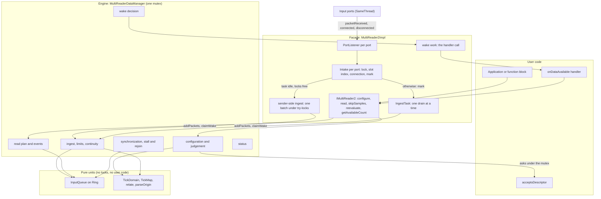

### Files

| File | Layer | Holds |
| --- | --- | --- |
| `multi_reader2_impl.h/.cpp` | Facade | `MultiReader2Impl`, `PortListener`, `Intake`, `Core`, `Wiring`; params checks, port takeover, ingest runs, handler calls |
| `multi_reader2_ingest_task.h/.cpp` | Facade | `IngestTask`: the state machine that keeps one drain at a time (dev's, unchanged) |
| `multi_reader_data_manager.h/.cpp` | Engine | `MultiReaderDataManager`: configure, judgement, read, ingest, synchronization, status, wake |
| `multi_reader2_queue.h/.cpp` | Unit | `InputQueue`, `Ring<T>`, `Event`, `SyncCause` |
| `multi_reader2_domain.h/.cpp` | Unit | `TickDomain`, `TickMap`, `relate`, `parseDomain`, `parseOrigin`, checked arithmetic |
| `multi_reader2_params_impl`, `multi_reader2_status_impl`, `multi_reader2_factory` | API objects | Unchanged from dev |

### Cost model

| Operation | Cost |
| --- | --- |
| Packet on the sending thread | Task idle and both locks free: one batch ingested on the sender (two try-locks, no scheduler call). Otherwise one atomic store and one compare-exchange, and a scheduler call only when the task was idle |
| Ingest of a data packet | O(1): queue push, counts, sync and critical limit checks. A pass over the inputs only while synchronizing and only for a packet that starts its input's front run, while an input is stalled or ahead (the rejoin check), or when the critical limit drops everything |
| Handler decision | O(1) per ingest: `readable()` reads the counts of healthy and short inputs |
| Stall check | One pass over the inputs at a read. At ingest while synchronizing, only once a contributing input sends past the planned tick (`stallCheckTick`): the earliest at which an input with nothing queued can fall more than the sync limit behind |
| Read | One pass over the inputs, plus the events it reaches; copies run outside the mutex |
| Status without changes | O(1): the previous object is returned |

---

## 4. Classes

### Facade

`Slot` is `MultiReader2Impl::Slot` in the code; it is named `FacadeSlot` here to tell it from the engine's.

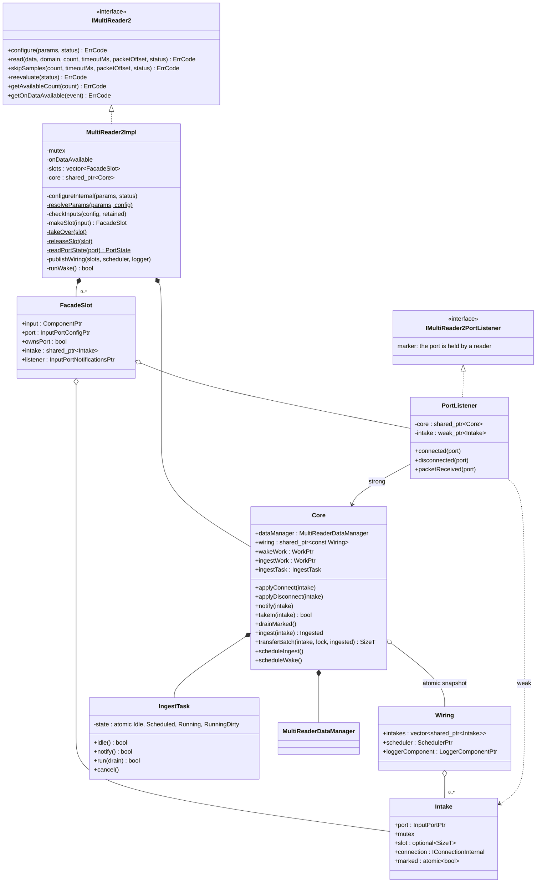

### Engine and units

`Slot` is `MultiReaderDataManager::Slot` in the code; it is named `EngineSlot` here.

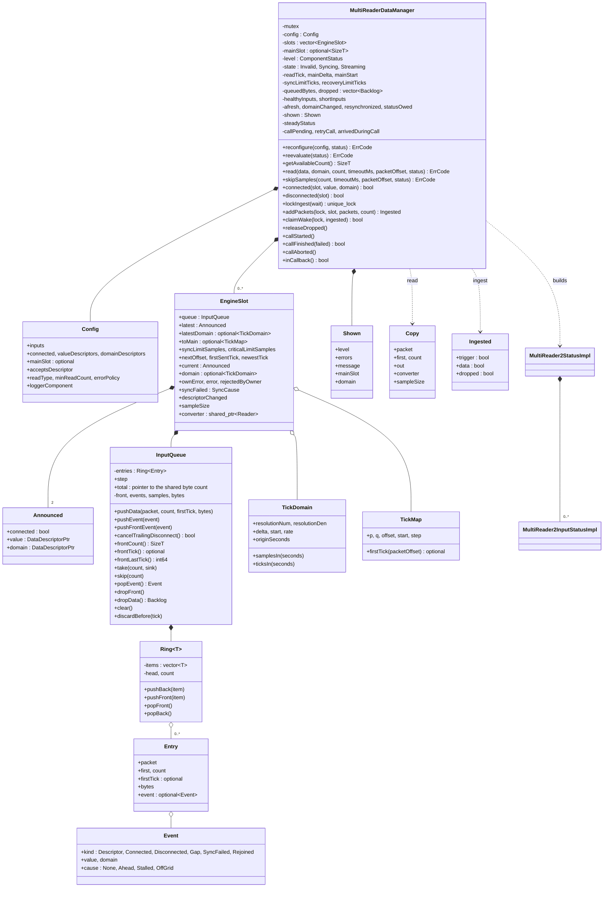

### Responsibilities in one line each

| Class | Owns |
| --- | --- |
| `MultiReader2Impl` | The COM object: params checks, the slots and their ports, configure's takeover and rollback, the handler call |
| `Core` | What callbacks and scheduled work need without the reader: the engine, the wiring snapshot, the two reusable works |
| `Intake` | One port's intake lock, its slot index (unset while it is taken over or after it left), its connection and its ingest mark |
| `PortListener` | The port's listener; forwards callbacks to `Core` with its intake. The port holds it weakly |
| `IngestTask` | That one drain runs at a time, that a packet during a drain is drained again, and whether a sender may ingest (`idle`) |
| `MultiReaderDataManager` | Every piece of reader state, under one mutex |
| `EngineSlot` | One input: what it announced last (producer side) and what is in force (consumer side) |
| `InputQueue` | One input's packets and events in order, with counts kept on every push and pop |
| `TickDomain`, `TickMap` | A domain that passed the constraints, and the map of its ticks onto the main grid |

---

## 5. Threads, locks and lifetime

### Who runs where

| Code | Thread | Locks it takes |
| --- | --- | --- |
| `packetReceived` | The sending thread | With the ingest task idle: the intake lock and the engine mutex, both only tried, for one batch of 64 packets. Otherwise none: an atomic store and `IngestTask::notify` |
| `connected`, `disconnected` | The thread that changes the port | The port's intake lock, then the engine mutex |
| Ingest run (`drainMarked`) | A scheduler worker, one at a time per reader | Per port: the intake lock, then the engine mutex per batch of 64 packets, up to 256 batches |
| Handler call (`wakeWork`) | A scheduler worker | None while the handler runs |
| `read`, `skipSamples`, `getAvailableCount` | The caller | The engine mutex; conversion after it |
| `configure` | The caller | The facade mutex, every affected intake lock, the engine mutex |
| `reevaluate` | The caller | The facade mutex, the engine mutex |
| `acceptsDescriptor` | Inside `read`, `configure` or `reevaluate` | Runs under the engine mutex; calls into the reader are refused |

Lock order: facade mutex, then an intake lock, then the engine mutex. No signal is called under an intake lock: a
signal's descriptors are read before the lock is taken, and the connection is compared after it. A sending thread only
tries its locks, so it never waits for a read, a configure or the ingest task: when either lock is taken it leaves the
packet to the task.

### A packet's way to the user

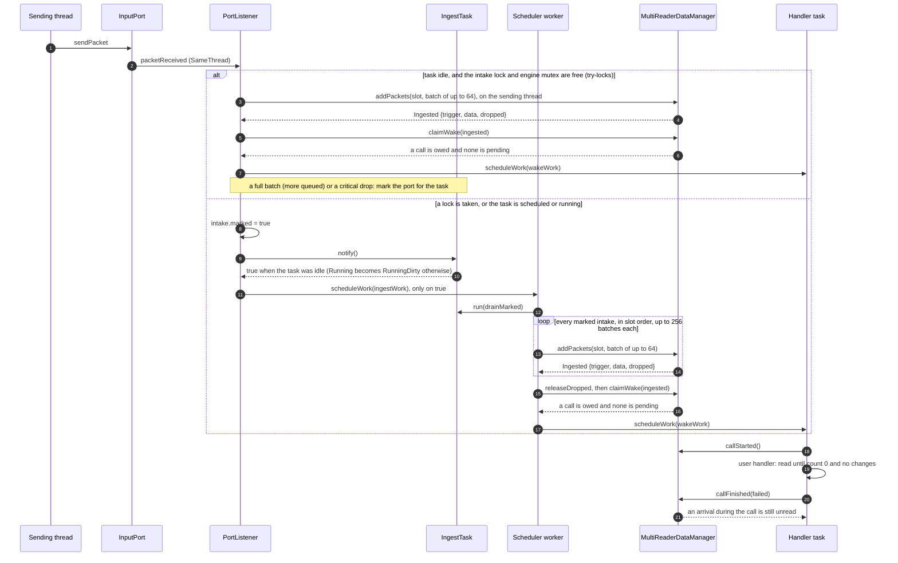

### Lifetime

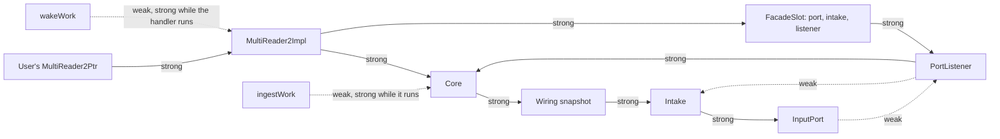

- Callbacks in flight hold `Core`, never the reader, so the user's last release destroys the reader at once.
- The destructor clears the wiring and unsets every intake's slot under its lock, so an ingest run still in flight
  leaves the ports alone; the ports come out with notification `None` and no listener.
- The handler call holds the reader only while the handler runs, and lets go of it before it asks for the next call.

---

## 6. Step by step: configure

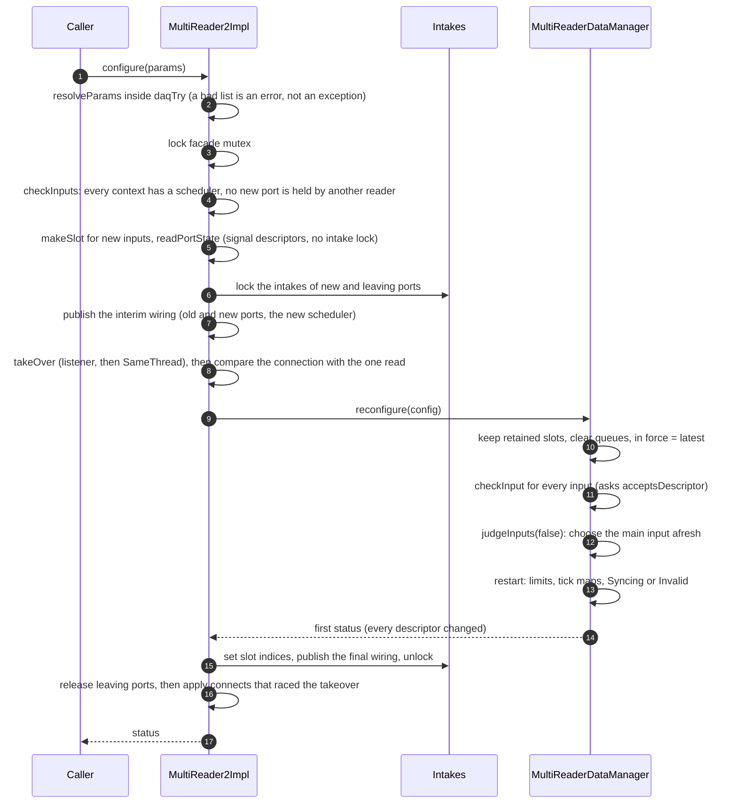

A takeover that fails releases the new ports and restores the old wiring, leaving the reader as it was.

---

## 7. Step by step: ingest

`addPackets` hands one port's batch to the engine under one lock. Each packet goes through `ingestPacket`:

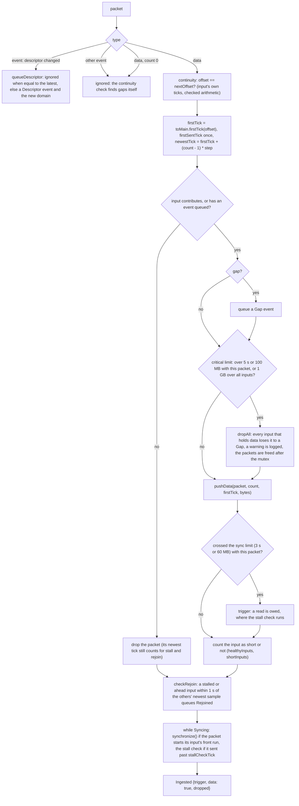

A gap on an off-grid input is queued even when the data is dropped, because a gap clears that failure.

After a sender's batch, or after the task's run over every marked port, `claimWake` decides in O(1): a call is owed
when an event, a synchronization outcome or a limit was ingested, or data was and `readable()` holds (streaming, at
least one healthy input, and no healthy input short of samples). A failed handler call is retried on the next
arrival.

### The limits

All three are measured in each input's own data time and bytes, so a slow input and a fast one get the same margin.

| Limit | Value | Crossed | Consequence |
| --- | --- | --- | --- |
| Sync limit | 3 s or 60 MB queued (soft) | At ingest: the crossing triggers a read | A read stalls every contributing input that has nothing queued while the others sent more than 3 s past it: `SyncFailed` with cause `Stalled`, the main input included. 3 s is also how far an input may start ahead of the main input |
| Recovery limit | 1 s | At ingest, for a stalled or ahead input | The input rejoins (a `Rejoined` event, applied by the next read) once its newest sample is within 1 s of the newest of the other healthy inputs, or on its own packet when no other healthy input has sent |
| Critical limit | 5 s or 100 MB per input, or 1 GB in all | At ingest, before the packet is queued | The inputs are read too slowly: every input that holds data drops it and queues a `Gap`, so each reports the loss and synchronizes afresh from the newest data. The dropped packets are freed after the engine mutex |

A packet alone never passes a limit, so the newest packet always fits: a slow signal with long packets stays readable.
The data an input sent while it was set aside is gone when it rejoins; data loss across such a recovery is expected.

The byte limits count the packets' value and domain bytes. With very small packets the memory the packet objects take
is several times that: with 10-sample Float64 packets about 1 kB per packet against 80 counted bytes.

---

## 8. Step by step: synchronization

`synchronize()` runs while the state is `Syncing`, after an ingested data packet that starts its input's front run, and
after a read applies events. Only such a packet can move the common start or finish the synchronization: the start is
the latest first tick, and an input whose data lies before it is emptied, so its next packet starts a run. Checking
every packet cost a reader of 1,024 inputs at 1 kHz more than the data, and it never reached the common start.
Every tick is a main tick from the main input's origin. M is the main input's newest sample.

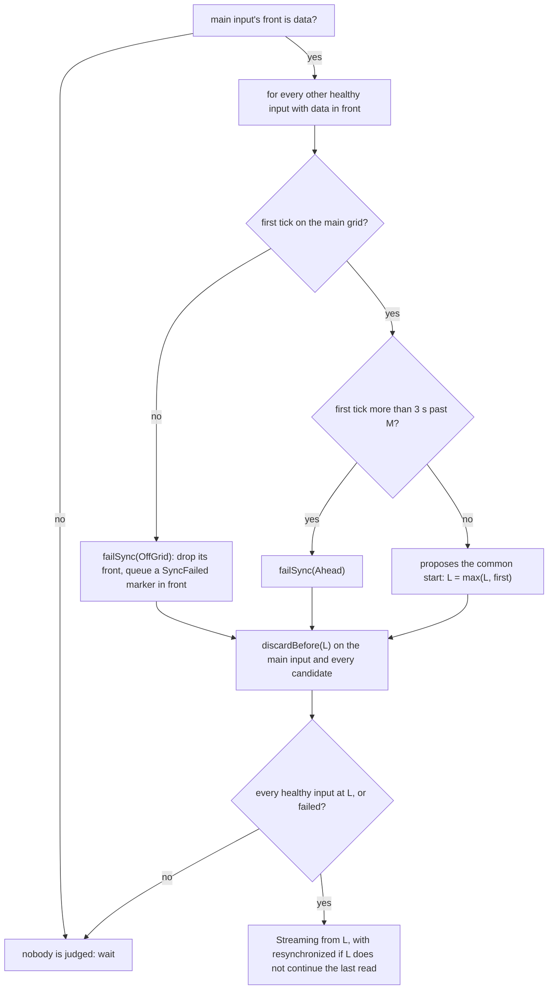

There is no "behind" rule: an input that has nothing at the common start is waited for, and one that stays silent
while the others send more than 3 s past it is stalled by the next read (`applyStalls`). A stall is the input's own
error, so it survives a change of the main input; `Ahead` and `OffGrid` are relative to the main input and are cleared
when the main input changes.

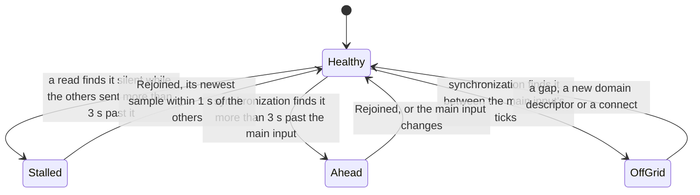

A failure is a marker in front of the input's queue. Ingest finds it; the next read applies it, so errors still change
only in read, configure and reevaluate.

---

## 9. Step by step: read

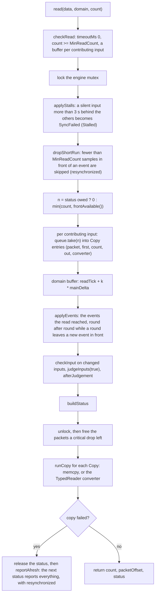

What the read applies:

| The input | Events it applies |
| --- | --- |
| Contributing (healthy, reader valid) | The events in front of it, which the read reached; consecutive ones together |
| Not contributing | Every queued event, dropping the data between them |

Then `afterJudgement` decides what follows: an internal reconfigure (validity changed, the automatic main input moved,
or the main domain changed), or set-aside inputs lose their front data, rejoining inputs resynchronize (dropping the
others' backlog if a rejoining input has nothing queued), and a contributing input's gap or new domain resynchronizes.

A round can leave a new event in front of an input with no data before it, such as the synchronization failure the
round's own synchronization found. `applyEvents` repeats the rounds until none is left, so the read that finds a
failure also reports it.

---

## 10. Judgement and the reader's state

### An input's error

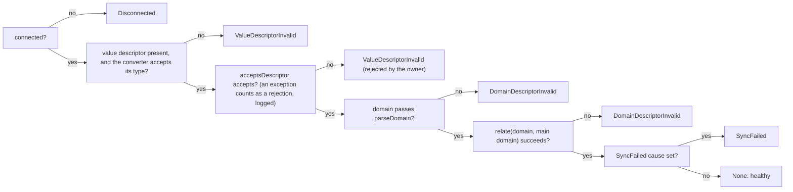

`checkInput` sets the input's own error (the first four checks); `judgeInputs` chooses the main input and adds the
checks against it. A stall counts as the input's own error, before the main input is chosen, so a main input the reader
chose gives way when it stalls; `Ahead` and `OffGrid` are checks against the main input. The main input is the pinned one, the kept one
while it is healthy, or the first healthy input, preferring one that was synchronized with the main input it replaces.

### The reader's state

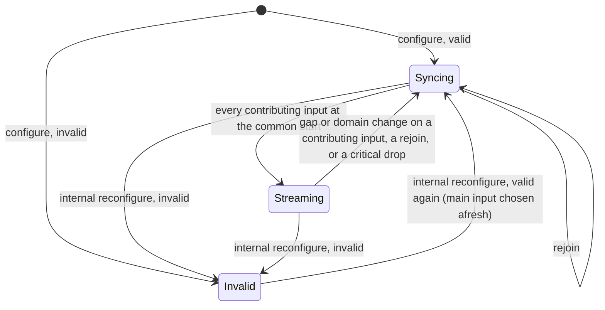

| Level | Under `Invalidate` | Under `Exclude` |
| --- | --- | --- |
| `Ok` | No input in error | No input in error |
| `Warning` | Never | Some inputs in error, at least one healthy, a pinned main input healthy |
| `Error` (invalid) | Any input in error | No healthy input, or the pinned main input in error |

---

## 11. Status

A status has two kinds of fields. State fields (level, message, main input, domain descriptor, each input's error) are
captured in `Shown`; event fields (`domainDescriptorChanged`, `resynchronized`, each input's `descriptorChanged`) are
flags set where the event happens.

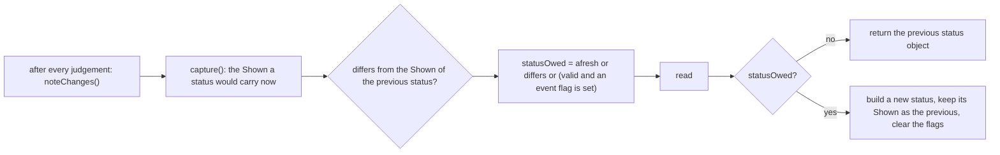

- A change undone before the next read shows no change, which is what "nothing differs from the previous status" says.
- While a status is owed, reads return count 0 and `getAvailableCount` is 0, so samples never cross a change.
- Event fields are never reported under `Error`.

---

## 12. The handler call

The handler is announced for new arrivals, not for what is left (spec, Data available triggers). The engine keeps two
flags: `callPending` (a call is scheduled or running) and `arrivedDuringCall`.

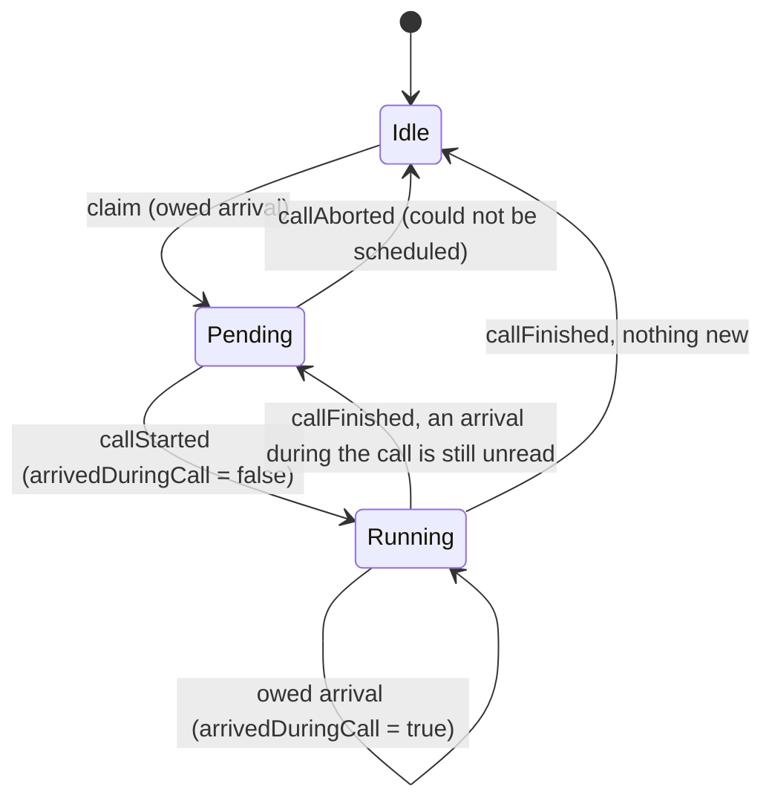

A handler that throws is logged and kept, and the next arrival calls it again for whatever is pending (`retryCall`).
With no handler subscribed, a claimed call is released at once instead of scheduled, so a reader read from a loop
costs no scheduler work for calls.

---

## 13. The pure units

### InputQueue

```
 front run (readable)                     behind the first event
+----------+----------+----------+-------+----------+-------+----------+
| data     | data     | data     | Event | data     | Event | data     |
| t=1000   | t=1040   | t=1080   | Gap   | t=5000   | Desc  | t=5040   |
| 4 left   | 4        | 4        |       | 4        |       | 4        |
+----------+----------+----------+-------+----------+-------+----------+
 ^ head of the ring
 frontCount = 12   eventCount = 2   sampleCount = 20   byteCount = all packet bytes
 frontTick = 1000  frontLastTick = 1000 + (12 - 1) * step
```

- Every data entry keeps the main tick of its first unread sample, so trimming to a tick (`discardBefore`) and the
  synchronization check need no walk; a run holds one sample every `step` ticks, as a gap ends a run with an event.
- `pushData`, `take` and `popData` keep every count; only `popEvent` counts the next run. `dropData` hands the dropped
  entries back, so the engine frees their packets after its mutex.
- A queue may point at a byte total shared by all queues (`total`), which every push and pop keeps: the critical
  limit's 1 GB over all inputs is one comparison.
- `Ring<T>` is a power-of-two array that grows when full and halves when a quarter full. MSVC's `std::deque` stores
  one element per block for elements over 8 bytes, so it allocated and freed a block for every packet.

### TickDomain and TickMap

`parseDomain` accepts a domain that meets the constraints an input meets on its own (integer scalar ticks in seconds,
a linear rule with an integer delta above 0 and an integer start, an integer rate, an ISO 8601 origin on a full
second). `relate(input, main)` maps an input onto the main grid:

```
main tick of a packet = (packetOffset + start) / q * p + offset     when (packetOffset + start) % q == 0
p / q  = input tick resolution / main tick resolution, reduced
offset = (input origin - main origin) * main resolution denominator / numerator
step   = main delta (equal rates: one input sample is one main sample)
```

Every operation is checked Int64 arithmetic: an overflow is a failed constraint, never a wrong tick, and the limits
(`samplesIn`, `ticksIn`) saturate. `parseOrigin` reads the offset itself (`Z`, `+hh:mm`, `+hhmm`, `+hh`), because the
shared parser reads `+01:30` as `+01:00`; the shared parser is left as it is for the other readers.

---

## 14. Robustness

The fixes to the findings of the external reviews of dev and review:

| Problem | Where it was | v3 |
| --- | --- | --- |
| A period that overflows divides by zero | dev | `checkedMul` in `parseDomain` |
| `configure` throws across the ABI for a list holding an Integer | dev | `resolveParams` inside `daqTry` |
| ISO offsets with minutes read wrongly | dev (shared parser) | Own `parseOrigin` |
| Unchecked duration multiplies | review | `samplesIn` and `ticksIn` saturate |
| A status with changes lost when a copy fails | dev | `reportAfresh`: the next status reports everything, with `resynchronized` |
| Another reader's port recognized by `dynamic_cast` | dev | Marker interface `IMultiReader2PortListener` |
| A copy of the convertibility table | dev | The converter's `handleDescriptorChanged` decides |
| A busy port holds up the other ports and the handler | review, dev | At most 256 batches (16,384 packets) per port per run; the port is marked again and the run repeats. A tighter bound (1,024 packets) cost a quarter of the throughput of a saturating stream |
| A call is scheduled for every arrival with no handler subscribed, and re-schedules itself while data stays unread | dev | No call without a subscriber; the claim is released |
| A pass over all inputs for every packet while synchronizing: with 1,024 inputs at 1 kHz the reader never reaches the common start | dev; v3 until the gate | The pass runs only for a packet that starts its input's front run; the stall check is planned ahead (`stallCheckTick`) |
| The port's connection cached without a reference: a disconnect racing an ingest calls into a destroyed connection (found by the concurrency suite, about 1 run in 10 of one case) | v3 during the port of sender-side ingest | The intake holds a reference; packets sent before the disconnect are still ingested ahead of it |
| Descriptors read under intake locks lose a reentrant disconnect | review | Not taken: read before the locks, connection compared after |
| A packet in configure's takeover window waits for the next packet | dev | The interim wiring carries the new scheduler |
| Descriptor comparisons walk the whole descriptor | dev | Identity first, value only for different objects |

Unchanged on purpose, as the spec requires: `acceptsDescriptor` runs under the engine mutex (calls into the reader from
it are refused), the handler is edge-triggered, and the status message carries the spec's texts.

---

## 15. Extending to the Future design

### The seams

1. **`relate()` and `TickMap`**: how an input's ticks map onto the main grid.
2. **The queue's ticks**: each data entry knows the main tick of its first sample, and the queue knows its `step`.
3. **The read plan**: `frontAvailable()` says how many main samples every contributing input can deliver; `take()`
   turns an input's share into copies that run outside the mutex.
4. **`synchronize()`**: the only place that decides the common start.
5. **Markers in front of a queue** (`failSync`): a finding at ingest that the next read applies as an error.

### Where each item lands

| Item | Change | Where |
| --- | --- | --- |
| Reading with timeout | Wait on a condition variable until `frontAvailable() >= count` or a status is owed; `claimWake` notifies it | `read`, `checkRead`, `claimWake` |
| Configurable limits | The three limits from settings instead of constants | `restart`, `ingestData` |
| Start on a full unit | Round the common start up to the next whole second | `synchronize` |
| Off-grid tolerance | Round to the nearest main tick within the tolerance | `TickMap::firstTick`, the grid check |
| Fractional and relative origins | The origin as a ratio; a sub-tick shift; relative domains relate with offset 0 | Domain unit |
| Reference domains | Parse the reference domain info; refuse a mismatch; add its offset | Domain unit |
| Unscaled and raw reads | The read mode in `makeConverter`; raw copies `getRawData` | `makeConverter`, `runCopy` |
| Overflow detection | `dropAll` queues an overflow marker instead of a gap, and the status reports it | `dropAll`, `applyEvent`, status |
| Data loss monitoring | In place in v1 through the limit model: `newestTick` per input, the stall and the rejoin. A dedicated status field would read them | Status |
| Dividers | `relate` accepts an integer rate ratio; the input's `step` becomes that multiple; the read plan counts main ticks | Domain unit, queue step, read plan |
| Resampling, explicit domains, asynchronous signals | An aligner per input between the queue and the copy: how far it can produce values (interpolation needs the next sample; sample-and-hold of an asynchronous signal holds its last value up to the main input's newest tick) and the values themselves, with its history kept across reads. The identity aligner is v1 | Read plan, queue entries, `synchronize` |
| Fill policy | A Fill input does not gate the read plan; its aligner writes zeros where it has no data | Read plan, judgement |
| Seamless rejoin | A healed input is pending with a join tick; the read plan stops there as at an event; no resynchronization | `afterJudgement`, read plan |
| Lock-free ingest | One SPSC queue per port; synchronization and limits move to the read side. Sender-side ingest already takes the scheduler out of the common path | Ingest, `synchronize` |

Several items share one change: the read plan counting in main ticks instead of samples. v1 counts samples because one
input sample is one main sample; the queue already carries the ticks, so that change stays inside `frontAvailable`,
`shortRun`, `take` and `synchronize`.

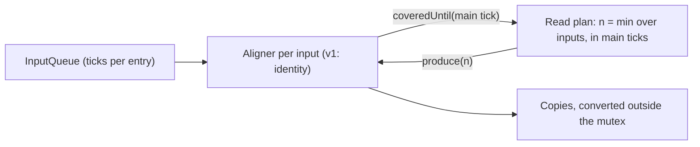

---

## 16. Tests and performance

### Tests

| Suite | Result |
| --- | --- |
| `test_reader` (legacy readers, the MultiReader2 suite, white-box units) | 2,503 pass, 38 skipped (behaviour v3 does not take from review), 0 fail |
| `test_ref_fb_module`, `test_basic_csv_recorder_module` | 110 and 16 pass |
| Random-seed runs: the MultiReader2 suite 12 times, the function block suites 6 times each | Clean. The harness race in `ThrowingHandlerIsLoggedAndCalledAgainOnlyOnNewData` (an asynchronous logger counted before it wrote) is fixed in the harness: 0 failures in 200 runs |

The limit and synchronization tests (`test_limits.cpp`, `test_synchronization.cpp`) are review's, as the limit model
is; the markers for the old stall and sync-limit behaviour are gone from the other files.

`tests/multi_reader2/test_domain_and_queue.cpp` tests the domain unit, the queue and the ring on their own, and the
regressions of the external reviews (period overflow, origin offsets, saturated limits, a bad input list).

### Performance

Measured on one machine in one session, the three readers interleaved per scenario: dev at cbec3835, review at
7ed94614 and v3 as described here. `bench_mr2` medians of 5 runs; `bench_mr2_stream` with zero-copy producers. Windows
granted a 1.9 ms timer for the paced runs, the same for all three.

| Case | dev | v3 | review |
| --- | --- | --- | --- |
| Stream, 64 inputs x 100 samples (MS/s) | 56 | 69 | 29 |
| Stream, 64 inputs x 1,000 samples (MS/s) | 314 | 542 | 216 |
| Stream, 16 inputs x 1,000 samples (MS/s) | 502 | 654 | 630 |
| Read from a backlog, 4 inputs x 1,000, chunk 100 (MS/s) | 321 | 1,022 | 283 |
| Read from a backlog, 32 inputs x 10, chunk 100 (MS/s) | 25 | 46 | 28 |
| Ingest, 32 inputs x 1,000 samples (MS/s) | 1,017 | 1,148 | 932 |
| Polling latency p50 / p99, 16 inputs x 100 (us) | 85 / 468 | 63 / 243 | 371 / 4,756 |
| Handler latency p50 / p99, 16 inputs x 100 (us) | 61 / 169 | 54 / 155 | 50 / 174 |
| Fixed load 64 x 50 kS/s, handler: CPU cores; p50 / p99 (us) | 0.26; 123 / 246 | 0.25; 97 / 220 | 0.25; 100 / 220 |
| Scale at 10 kHz per input: most inputs kept up, handler / poll | 2,048 / 2,048 | 3,072 / 4,096 | 1,024 / 1,024 |
| Scale at 1,024 inputs, handler: CPU cores; p50 / p99 (ms) | 0.46; 1.7 / 2.8 | 0.42; 1.0 / 1.9 | 0.42; 1.2 / 2.2 |
| 64 inputs x 1,000 samples at 16k packets/s (1 GS/s), handler | 1 of 2 runs kept up | 2 of 2 | 0 of 2 |
| First packet incl. synchronization, polling, 16 inputs x 100 (us) | 1,102 | 867 | 134 |
| Int32 to Float64, 4 inputs x 10,000 samples (MS/s) | 1,549 | 1,602 | 2,146 |

- **Where v3 leads**: many inputs, reads from a backlog, polling latency, scale and the highest loads. Under the five
  fixed loads its CPU is at or below dev's, and level with review's except at 4 x 10 MS/s, where review uses less.
- **Level within noise**: large packets on few inputs, which are bound by memory bandwidth; their repetitions spread by
  up to 2x for every reader, the unchanged legacy reader included.
- **Where review leads**: the first packet after construction (v3 is level with the legacy reader there), and Int32 to
  Float64 conversion of large packets, where review's own loop beats `TypedReader`'s.
- **Trade-off**: at saturating packet rates with 4 to 16 inputs, v3 calls the handler sooner than dev, for 5 to 8 times
  lower latency, and uses about as much CPU as review, more than dev.
- **Shared limit**: with few inputs and 10-sample packets all three ingest about 1 MS/s, because a reader faster than
  its producer wakes the ingest task once per packet.

The benchmarks (`bench_mr2`, `bench_mr2_stream`) come from the comparison worktrees and are not part of this branch; the
full tables are in the review document `0007-multi-reader-2-v3.md` in the knowledge base.
